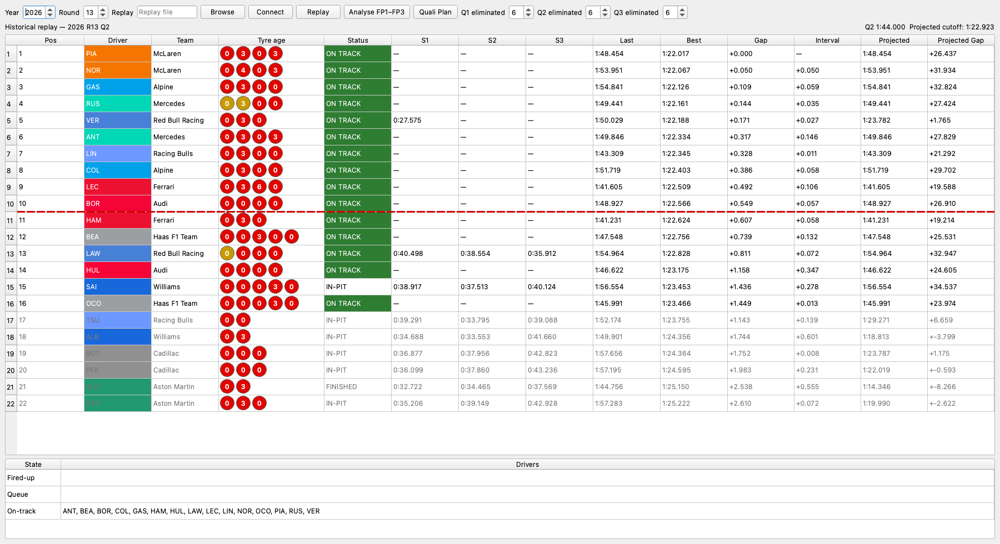
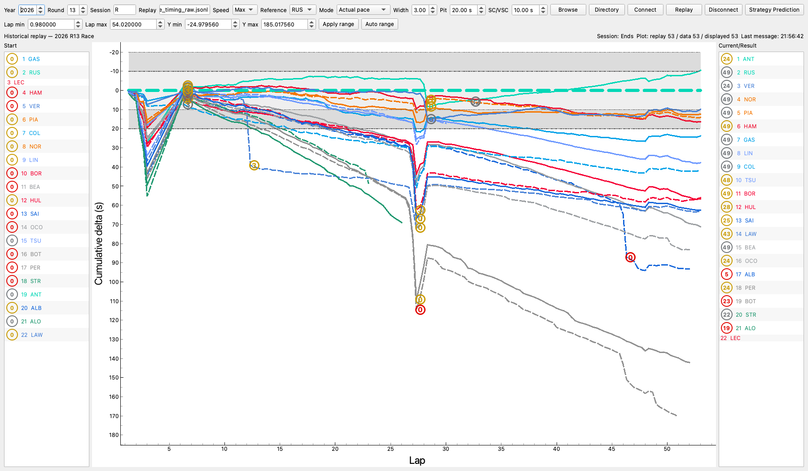
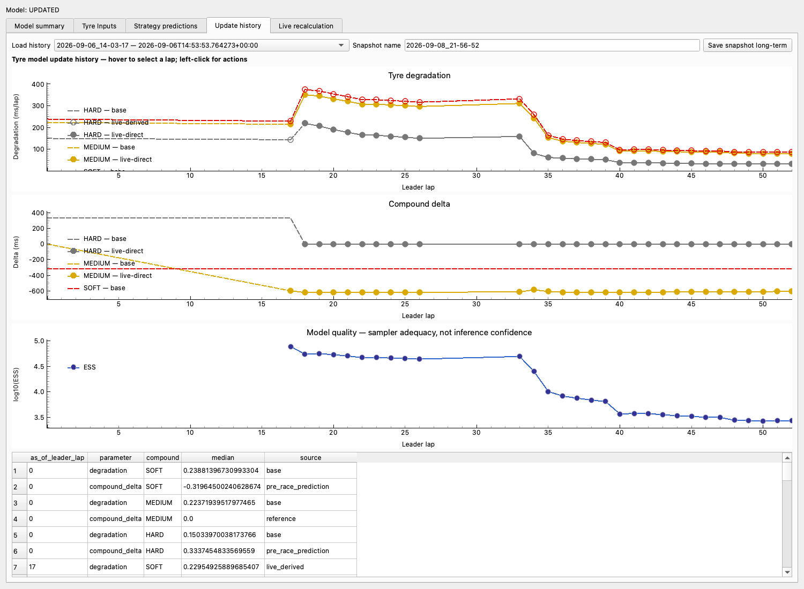

# woPlanner

`woPlanner` is an interactive Formula 1 decision-support application for
qualifying and race sessions. It combines public timing data with `woStrategy`
models and `woData` recordings to monitor qualifying, inspect completed races,
follow live timing, replay a session deterministically, update tyre assumptions,
search strategies, and compare race what-ifs.

The examples below are real **2026-R13 Italian Grand Prix** data rendered through
the application. They are historical analysis/replay views, not a mocked UI.

## Qualifying, race and model views

### Qualifying monitor



The Q2 replay combines the projected elimination cut with current sectors,
run/pit state, gaps and each driver's tyre history. Track evolution is refitted
as eligible push laps complete.

### Race live / replay cumulative delta



The same reduction and rendering path is used for live data and deterministic
replay. This completed-race view uses Russell as the selected actual-pace
reference and retains start/result rankings, compound markers, retirement
treatment, and normal versus SC/VSC pit-loss bands.

### Strategy Prediction update history



The model layer records how degradation and compound-delta assumptions evolved
at causal leader-lap cuts. Dashed/solid source styling distinguishes assumed,
derived and directly Race-informed values; ESS is shown as sampler-adequacy
diagnostic, not inference confidence.

## What to inspect

- [`src/woplanner/quali`](src/woplanner/quali) — qualifying projection, run state
  and track-evolution monitoring.
- [`src/woplanner/live`](src/woplanner/live) — live/replay ingestion boundary,
  cumulative-delta view and telemetry worker.
- [`src/woplanner/analysis`](src/woplanner/analysis) — tyre inputs, live model
  updates and exact Strategy Prediction searches.
- [`src/woplanner/standard`](src/woplanner/standard) — completed-race analysis
  and strategy what-if editing.
- [`doc/`](doc) — calculation rules, architecture, deliberate compromises and
  validation notes.

All analysis uses public F1 data. Strategy outputs depend on model assumptions
and incomplete public timing context; they are engineering decision support,
not claims of team-grade ground truth.

## Package layout

The source package is organized by ownership:

```text
woplanner/
├── common/    # presentation and policies reused by planner modes
├── analysis/  # model analysis, workers, tyre inputs, prediction UI
├── standard/  # completed-session race planner
├── live/      # live race planner and telemetry pipeline
└── quali/     # qualifying planner and live monitor
```

Planner-specific code should remain in its planner package. A component moves to
`common` only when multiple planner modes reuse the same behavior; analysis
functionality belongs in `analysis` even when standard and live GUIs both open it.

## Qualifying monitor

Run `woplanner-quali` for the live Qualifying/Sprint Qualifying timing table and
run-plan editor. It supports FastF1 live timing and deterministic raw-recording
replay, automatically follows Q1/Q2/Q3 or SQ1/SQ2/SQ3, projects the elimination
cutoff, shows pit/track state and real tyre age at stint start, and recalculates
linear track evolution as qualifying push laps finish.

The complete operating guide, state definitions, calculation rules, replay
example, and deliberate compromises are documented in
[`doc/QUALIFYING_MONITOR.md`](doc/QUALIFYING_MONITOR.md).

## Local development

For local development from the sibling checkout layout:

```bash
pip install -e ../Fast-F1
pip install -e "../woData[live]"
pip install -e ../woStrategy
pip install -e .
woplanner
```

## Exporting plots

The completed-session planner's **Export** menu supports:

- PNG at the current on-screen size, saved to a file or copied to the clipboard.
- UHD 4K PNG at 3840 × 2160, saved to a file or copied to the clipboard.
- SVG vector plot output for scalable editing and publication.

The 4K export preserves the entire visible plot. When the 16:9 output requires
more plotting range, woPlanner expands the narrower axis equally on both sides;
it never crops or contracts the selected range. The original window size and
plot range are restored after export.

SVG export contains the graph, axes, labels, curves, tyre markers, and track-
status bands as vector content without embedded raster images. It intentionally
excludes the Start and Current/Result ranking panels. All export formats hide
temporary hover and pit-target overlays from the exported image and then restore
them on screen.

## Live mode

Run `woplanner-live` for the live observation view. It uses FastF1's browser
authentication, subscribes only to the Phase 1 timing topics, and records every
canonical raw message before applying it. The replay picker accepts both merged
archive `*.jsonl` files and legacy live `*.txt` recordings for max-speed, 1x, 5x,
or 20x replay.

Live mode can plot provisional sector-level deltas as soon as S1, S2, or S3
arrives, before the whole lap completes. These display points may appear, move,
change lap assignment, or disappear as evidence changes. Certified sectors and
completed-lap fallbacks come from woData's committed history; provisional
display timing does not certify that history.

Fresh official gaps guard the newest shared-coordinate provisional points
against materially reversed ordering. Gap observations must postdate the
points, be at most **5 seconds** old, and be within **2 seconds** of each other.
Contradictory provisional deltas are suppressed only when both the official and
displayed differences exceed **0.1 seconds**. This is a presentation-only rule.
Where a pace reference is still unavailable, a same-coordinate provisional
reference comparison may provide a revisable live estimate.

`Finished`, `Finalised`, `Ends`, or completed replay switches the display to
canonical-only timing and rebuilds the plot. Suspension, red flag, aborted or
transient states, and ordinary disconnect do not finalise the display. MC,
traffic, tyre fitting, and persisted analytical inputs use committed/reconciled
data only; provisional timing and display gap corrections never enter analysis.
After the feed explicitly marks a running driver `Retired`, that driver's curve
ends at the last completed lap instead of accumulating later placeholder timing.
Both live and post-race planners default to averaged reference mode; the mode
selector can switch back to actual reference pace.

Hovering near a Live curve highlights the driver and shows driver, lap, sector,
cumulative delta, compound, and tyre age. Incremental `TimingAppData` is retained
by the shared reducer: compound changes are drawn as colour-coded tyre markers,
and the start/current rank lists include compact compound and tyre-age labels.
Tyre markers are reconstructed from the current authoritative lap history after
every Cumulative Delta redraw. Consequently, a known stint change remains on the
plot as later laps arrive, after pan/zoom or Auto range, and after live-session
recovery; a corrected compound assignment replaces the corresponding marker.
Live and standard mode share the same detailed hover matching. Clicking a live
curve selects and emphasises that driver without changing the top-bar reference.
Both modes use the common curve-click binding, hover-label overlay, pit-window
overlay, and Lap/Y range-control component. Native curve selection drives the
selected driver's pit-loss overlay using independently resolved **GREEN**,
**SC**, and **VSC** values. An unresolved state produces no band. The overlay
follows current selected-driver timing through refresh, driver switch,
deselection/reselection, and the final canonical redraw. Applied ranges remain
fixed across timing updates and **Auto range** resumes data-driven bounds.

Live Cumulative Delta uses one fixed intra-lap geometry for every driver and
lap. The current live snapshot has no circuit sector-distance boundaries, so it
uses the selected reference driver's earliest complete lap to derive cumulative
S1/S2/S3 time fractions; equal thirds are the final fallback. The averaged
reference uses the selected driver's positive observed mean time for each sector
and repeats those same three means after that driver retires. It does not switch
to a surviving-driver population. Its cumulative origin follows logical timing
coordinates, so unrelated peer rows disappearing cannot reset historical
reference timing. Legitimate new reference-driver samples can still update the
averages; live provisional samples participate only in the live display. When
completed-lap fallbacks are present,
averaged-reference mode uses one homogeneous timing resolution rather than
mixing sector-level and lap-level reference samples.

To replay a completed archive, click **Browse**, select
`merged_replay_v1.jsonl` from the matching
`wodata/live_archive/schema_v1/year=.../round=.../session=.../replay/` directory,
choose Max/1x/5x/20x, and click **Replay**. The same reducers and rendering path are
used for JSONL archive replay and live SignalR messages.

Committed plot history uses woData's canonical racing-time axis. Missing
canonical anchors remain unavailable rather than becoming zero; a provisional
live comparison does not repair or replace those historical anchors. The
shared **Strategy Prediction** window consumes the committed portion of the
live snapshot: when the leader lap advances it requests recalculation.
Default automatic traffic returns `traffic-unavailable` and retains model state;
checking newly eligible sector-filtered laps requires explicit sector mode.
Replay expands batched leader-lap jumps
into point-in-time snapshots and processes them through a FIFO recalculation
queue. Replay-state reduction and Cumulative Delta rendering do not wait for
that FIFO: the UI reports the number of historical cuts still awaiting input
preparation while the race view continues to advance. Prepared inputs and the
process queue are bounded, but lightweight causal cut requests are retained
until every historical result has been evaluated. Live mode does not queue an
update received while calculation is active; the newest accumulated data is picked
up by the next leader-lap trigger. In explicit sector mode, unchanged clean-lap
fingerprints are skipped quickly. Updated models record their version and refresh sequence-level strategy
predictions after replay's queued model updates drain. Missing internal lap
timing still invalidates later cumulative deltas
for that driver instead of assuming the missing lap took zero time.

Use **Latest** to load the latest completed race FastF1 can find and set the
reference driver to the race winner. The plot uses an inverted y-axis so slower
cars appear lower, with start order on the left and current/result order on the
right.

## Strategy Prediction window

Both `woplanner` and `woplanner-live` use the same modeless **Strategy Prediction**
window. It reads
canonical schema-v1 weekend models, displays uncertainty/support diagnostics, runs
up-to-10 compound-sequence searches in a worker thread, optimizes pit timing once
per sequence, renders proportional stint bars, persists results, shows parameter
history plots, supports editable degradation/delta overrides, and allows up to
three pinned comparisons. In live mode, selecting a driver fills the current lap,
compound, and tyre age from the feed.

**Completed lap** uses the observed race progress in Auto mode. Check **Use
override** to enter a Manual completed lap; **Calculate Top 10** then uses that
value as its race-progress anchor for remaining distance and absolute pit laps.
With no selected driver, pre-race or manual planning starts a new strategy at
that anchor and can choose any available starting compound, including after lap
zero. Selecting a driver instead continues that driver's current strategy.
Changing the Manual anchor does not rewind canonical live-session state or
historical tyre models. The Auto/Manual choice and entered value are remembered
with the other Strategy Prediction controls.

### Current-event inputs and historical what-if mode

`CURRENT_EVENT` uses the canonical editable event configuration in
`woWeekend/configs/race.json`. Missing configuration, a season/round mismatch,
or a required unresolved value is displayed as **Unresolved** and blocks the
affected calculation. Failure to load current-event configuration does not
silently select another mode, and local 57-lap or 20-second assumptions are not
current-event fallbacks. Scheduled/live lap counts may be displayed but do not
overwrite the canonical configured current-event distance.

`HISTORICAL_WHAT_IF` is an explicit replay/offline mode in which hypothetical
assumptions remain editable. Its values are not promoted into current-event
configuration merely because a current configuration is unavailable.

Editing a pit-loss field changes only the UI draft. **Apply pit losses** validates
the complete prospective race configuration, atomically updates the editable
configuration, and mirrors the accepted event state into woData's durable
season/round operational record. A failed validation, identity resolution, or
history mirror does not leave configuration and history at different accepted
states. GREEN, SC, and VSC remain separate; unresolved values remain unresolved,
and legacy combined `sc_vsc` is context-only rather than a substitute for either
SC or VSC.

Live meeting identity is cached with its `(season, round)` owner. A year, round,
or conflicting meeting transition invalidates that ownership and requires
canonical identity for the requested event before durable persistence. Compatible
same-event metadata may be reused without repeated resolution.

The shared **Tyre Inputs** tab and the live/replay worker architecture are
documented in
[`doc/FP_TYRE_LIVE_INTEGRATION.md`](doc/FP_TYRE_LIVE_INTEGRATION.md). In
particular, FP analysis is explicit-only: opening either application, this
window, the tab, history, or replay never calculates or downloads FP data.

The result-count control chooses how many distinct compound sequences the exact
strategy search should return. This search does not use Monte Carlo samples. The
separate sample-count control on **Live recalculation** is initialized from the
latest compatible resolved race-review settings when available, otherwise from
the pre-race model configuration, and remains editable. The value shown in the UI
is passed explicitly to recalculation and therefore wins over a stored value.

**Rules compliant** is an opt-in filter for dry strategy searches. When checked,
every returned plan must use at least two distinct compounds from SOFT, MEDIUM,
and HARD across the complete strategy, including the current stint during an
in-race continuation. It can therefore return fewer rows than the requested
result count, or no result when the remaining laps/stops cannot satisfy the
constraint. Unchecked retains the unrestricted historical search behavior.

The label is intentionally a narrow convenience rather than a complete sporting-
regulations engine. It implements only the two-distinct-dry-compound constraint;
it does not infer wet-race exemptions, tyre-set availability, event-specific
mandates, race-control declarations, or other legality conditions. This keeps the
deterministic optimizer independent of incomplete live sporting context, at the
cost of requiring the user to decide when the checkbox is applicable.

Resolved fitting settings use this precedence: successful event cache metadata,
event-specific `latest_resolved_settings.json`, global
`latest_resolved_settings.json`, then the pre-race model configuration. The first
choice reproduces the settings behind an existing event result; the invocation
artifacts allow a race-review command to communicate its intended settings even
when no Monte Carlo result was produced. Only fields with a direct joint-model
meaning are overlaid. Race-review-only controls are intentionally ignored because
the live joint model does not implement the same parameterization.

Strategy Prediction remembers its controls, selected tab, and live settings in
`strategy_prediction_state.json`. Event-specific manual tyre inputs are instead
shared through `manual_tyre_inputs_v1.json` under the event weekend-model root.
Replay state is stored
beside the selected replay file; live state is stored beside that connection's
raw live-timing recording. The offline planner falls back to the event's canonical
weekend-model directory.

Replay uses a fresh in-memory value-versus-lap plot every time Replay is pressed.
It restores settings but does not retain generated strategies or the working plot
unless **Save snapshot long-term** is pressed. Live mode automatically updates one
durable whole-plot snapshot. The Update history selector reads only these saved
whole plots; it starts at **Select saved plot**, leaving the table and chart empty.
Legacy per-analysis history CSVs are no longer used by this selector.

Update history displays tyre degradation and compound delta in separate labelled
charts. Hovering either chart snaps a synchronized vertical cursor to the nearest
recorded leader lap and shows every compound's degradation and relative pace.
Hovering near a compound curve temporarily uses that compound as the `0.000 s`
pace reference; elsewhere the configured default reference compound is used.
Hovering never changes the stored model values. Left-clicking opens **Use lap N tyre values for strategy
calculation**, which copies that lap's degradation and compound-delta values into
the editable **Used** inputs and opens the Strategy predictions tab.

Degradation keeps the session's initial HARD/MEDIUM/SOFT ratios fixed. Before
any compound is directly informed it uses its resolved base value. Once a live
MC result directly informs a compound, uninformed compounds are derived from
that live scale and the fixed initial ratios; directly informed MEDIUM is the
preferred scale anchor. History renders base as dashed, live-derived as
dashed with hollow markers, and live-direct as solid with filled markers. This
resolver supplies Strategy Prediction as well as the chart. Compound delta is
not ratio-derived and retains its independent base-to-direct behaviour.
Each source segment owns the connector into the first point of the next segment,
so the obsolete baseline is not drawn beneath later history. Coordinates that
never become Race-informed remain dashed through the latest recorded lap, and a
missing compound delta remains absent rather than becoming zero.

The Live recalculation page's **Clean-lap details** dialog exposes required
tyre/stint metadata, allowed compounds, driver-relative quick-lap threshold,
consecutive-run minimum, run-start/end exclusions, and configurable clear-ahead
and clear-behind gaps. **Traffic source** defaults to **Automatic Race traffic
unavailable (model retained)**. Automatic telemetry traffic is quarantined and
reports `traffic-unavailable`; it produces no new Race update. Existing Race
model state, evidence counts and run/parameter history are retained. Repeated
requests report the same availability reason rather than an unexplained lack
of new clean laps. Position-derived traffic remains diagnostic and is not
activated for clean-lap decisions.

There is **no automatic sector fallback**. **Force sector-boundary only** remains
an explicitly selected existing mode using lap-start/S1/S2/lap-end crossing gaps,
marked as `SECTOR_BOUNDARY_FALLBACK`. Sector gaps are not blended into telemetry
means. Quarantined updates log new eligible laps separately from retained
evidence. In explicit sector mode, updates log previous and new clean-lap counts
and the FP/R source breakdown, total wall-clock calculation time, and remaining
queue length. The elapsed time can be compared directly with a normal lap time
when tuning the live Monte Carlo sample count. That sample count affects fitting,
not the number of telemetry traffic comparisons.

The **Tyre Inputs** tab separates editable Strategy inputs from read-only FP
LongRun evidence. Each Selected value is Manual when explicitly supplied and
otherwise the exact Legacy FP-derived fallback. FP contrasts are advisory and do
not automatically update Strategy values.

The **Strategy predictions** tab shows the exact tyre inputs used by the search.
The Tyre Inputs tab is the authoritative editor for the persisted pre-race
baseline; current Race-informed values continue to follow live/replay inference.
With **Manual Override** enabled, both direct and derived live degradation are
ignored and the resolved manual/pre-race/default values are used unchanged.
Physical-order checks are advisory only and never reorder or clamp manual values.
Baseline is displayed as seconds relative to the quickest compound, where
`0.0000` is quickest.

## Strategy simulation

`woPlanner` can create strategy what-if simulations for a loaded race. This is
still a projection, not a full race simulator: it does not model overtaking,
lapping, or traffic. By default, simulated futures are kept in the observed race
time domain by applying modelled strategy changes on top of the observed race
scaffold.

Before using simulation, run `woStrategy`'s `race_performance_review` for the
same race/session. By default, woPlanner discovers its outputs from the canonical
woData event directory:

```text
woData/wostrategy/race_performance_review/schema_v1/
  year={year}/round={round}/session={session}/
```

`woData` owns cache path conventions for normalized planner artifacts. With the
usual sibling-checkout workflow from the workspace root, generated planner caches
are written under `woData/`, not inside the `woPlanner` or `woStrategy` source
trees. `WODATA_ROOT` can override that location. The planner-facing tyre summary
is `tyre_information.csv`; it holds global and team compound baseline speed,
compound delta, and degradation values in one file. The detailed source and
Monte Carlo files remain beside it for strategy modelling and reproducibility.

Older flat files under `cache/race_performance_review/` remain readable for
backward compatibility, but new woStrategy writes use woData.

Required source files are named like:

```text
tyre_information.csv
race_performance_{year}_{round}_{session}_summary_baseline_pace.csv
race_performance_{year}_{round}_{session}_summary_fuel_rate.csv
race_performance_{year}_{round}_{session}_summary_track_rate.csv
race_performance_{year}_{round}_{session}_summary_compound_delta.csv
race_performance_{year}_{round}_{session}_summary_team_compound_degradation.csv
race_performance_{year}_{round}_{session}_sample_parameters.csv
race_performance_{year}_{round}_{session}_pit_loss_summary.csv
race_performance_{year}_{round}_{session}_clean_laps.csv
```

### Interaction

1. Load a race.
2. Hold Command on macOS or Ctrl on Windows/Linux while hovering a driver line.
3. The plot highlights the target as “pit after lap N”.
4. Click while still holding the modifier.
5. Choose compound, starting tyre age, pit-loss seconds, and lap-time mode.
6. Apply the simulation.

If the selected driver has no strategy-model row for a required compound but a
teammate has one for the same compound, the planner reports the missing driver
data and offers **Use team's data instead**. Accepting the option retries the
simulation with that teammate's model row while keeping the simulated driver's
identity, race laps, strategy edits, and team unchanged. If no same-team row is
available for the compound, the planner cannot offer this fallback.

Each driver has one active scenario containing ordered strategy edits. Adding a
new what-if pit to a driver that already has a scenario appends or replaces the
edit at that lap, then rebuilds the whole simulated future from the earliest
active edit. Future real pits remain active unless explicitly removed or
replaced by an added pit on the same stop lap. A confirmed team-data fallback is
stored on the scenario, so later edits and rebuilds continue using it without
asking again. **Strategy assumptions** and the scenario warnings identify when
the fallback is enabled.

Clicking tyre markers opens additional actions:

- simulated tyre marker: update the edit, inspect strategy deltas, or delete the
  edit;
- actual tyre marker: remove that real pit from the simulated strategy after
  confirming pit-loss estimate and lap-time mode;
- removed actual pit marker: edit the removed pit-loss estimate, restore the
  real pit, delete the edit, or inspect strategy deltas.

In `woplanner`, open **Retro Analysis → Strategy deltas** to inspect the
sector-level detail table and simulated
delta-to-reference chart. Same-driver model deltas remain in the table for
debugging, but the charted cumulative delta is relative to the selected
reference.

### Simulation algorithm

For a simulated driver A, two lap-time modes are available.

**Real-race adjusted - add observed issues** is the default. It calculates the
modelled what-if-vs-real-strategy tyre/strategy delta, preserves the observed
race residual for matching race conditions, then plots the resulting cumulative
time against the selected reference:

```text
race_domain_residual_A[sector]
  = observed_sector_time_A[sector]
    - modelled_observed_strategy_sector_time_A[sector]

sim_real_domain_lap_time_A
  = modelled_what_if_lap_time_A
    + race_domain_residual_A
```

For SC/VSC timing, residual carry-over is sector-aware. `woStrategy` exports
physical per-driver sector status, while `woPlanner` aligns the plotted status to
the race/leader lap-sector timeline. A driver's observed SC/VSC residual remains
on the physical sector where that driver experienced it, even when that sector
falls just outside the leader-aligned shaded SC/VSC period.

**Pure sim - model lap times** uses modelled what-if lap time directly and drops
observed race residuals:

```text
sim_real_domain_lap_time_A
  = modelled_what_if_lap_time_A
```

The simulated cumulative time connects to the observed cumulative time at the
last pre-edit lap. Observed cumulative time excludes inactive red-flag delays in
both standard and live mode, so applying or editing a pit simulation cannot
switch the plot between elapsed session time and racing time. The plotted y-axis
is always:

```text
display_cumulative_time(driver) - display_cumulative_time(selected_reference)
```

If the selected reference driver has an active simulation, all plotted deltas
are recalculated against that simulated reference trajectory.

The observed strategy baseline includes future real pit losses. When a real pit
is removed, the dialog's pit-loss estimate replaces the default loss in the
modelled observed-strategy baseline, but is not added to the simulated no-pit
strategy. In real-race-adjusted mode, any observed residual beyond that entered
loss is retained rather than treating the full observed pit sequence as pit loss.
The same residual retention applies when an earlier what-if stop causes a later
real stop to be skipped; SC/VSC pit loss is removed through the model delta.

Adding a what-if pit on the same lap as an observed stop is treated as replacing
that observed stop: the old observed pit residual is removed from the pit-in and
pit-out sectors, and the simulated pit uses the designated pit-loss seconds.

The optional team-data fallback changes only which driver row supplies the
model coefficients for a missing driver/compound pair. The simulated output is
still labelled as the selected driver and continues to use that driver's
observed race scaffold. It is therefore an explicit approximation, not an
inference that the two teammates have identical pace.

### Track status and pit-loss windows

Track status is classified at sector level when the planner lap cache includes
`Sector1TrackStatus`, `Sector2TrackStatus`, and `Sector3TrackStatus`:

- Safety Car: light yellow plot band;
- Virtual Safety Car: light orange plot band.

The same classification chooses the applicable GREEN, SC, or VSC operational
value for a stop. Only that state is required; an unresolved applicable state
blocks the calculation instead of borrowing another state, legacy combined data,
zero, or a local default. When `race_performance_review` has produced a supported
state-specific split, it can provide the pit-in S3 / pit-out S1 ratio while a
manually entered total remains the total used by the scenario.

The selected-driver pit window is the existing cumulative delta plus/minus each
resolved pit-loss value. GREEN, SC, and VSC envelopes are labelled separately;
an unresolved state produces no fabricated band. This is a timing envelope, not
a position-aware projected-rejoin calculation.

### Visual conventions

- Recorded driver lines stay visible.
- After a simulation is applied, that driver's original post-stop trajectory is
  faded to 50% transparency.
- The calculated trajectory connects from the last real lap before the earliest
  active edit.
- Simulated branches use custom dot-dash patterns:
  - solid base driver: `[1, 2, 8, 2]`
  - dashed base driver: `[1, 3, 4, 3]`
- Real tyre labels use solid rings.
- Simulated tyre labels use dotted rings.
- Removed real pit labels keep the solid ring and add a dashed cross overlay.
- Faded real tyre labels use 50% transparency.
- The Start column shows compact line samples for the real driver style and,
  when present, the simulated style.

Use **Clear sims** to remove all active simulations. A simulated tyre label can
also be clicked to update or delete that specific edit.

## Development notes

Pace and tyre inputs follow the shared
[`../woData/CANONICAL_PACE_CONTRACT.md`](../woData/CANONICAL_PACE_CONTRACT.md),
including MEDIUM operational normalization and legacy provenance compatibility.

See [doc/CODE_STATUS_QUO.md](doc/CODE_STATUS_QUO.md) for the current package
map, cache discipline, strategy simulation data flow, and future coding-agent
orientation notes.

This project is developed extensively with coding agents. Durable context
documents preserve architecture, assumptions, interfaces, known compromises and
validation requirements across development sessions.

### Track / Lap Position Map

The Track / Lap Position Map is available in main. **Track Map** opens a reusable,
non-modal window; closing hides it, and reopening synchronises the latest data
and selection. **Embedded Map** shows or hides the same presentation below the
timing plot. Live/replay refresh and the final canonical timing redraw preserve
the map window.

Curve clicks, driver-name clicks and map-marker clicks share the Planner's
selected driver across the timing plot, embedded map and detached map. The map
shows actual `Position.z` coordinates. A completed non-pit lap's recorded spatial
trajectory supplies the approximate reference for the selected driver's time
offset markers; unavailable reference geometry is shown explicitly.

GREEN, SC and VSC window values resolve independently from current-event inputs.
An unresolved state produces no markers or bands. These spatial windows are
visual aids, not a new projected-rejoin or race-order prediction authority, and
map state does not enter MC or tyre analysis.

### Strategy Prediction: History Info

The **History Info** tab contains only prior-edition Safety Car and Red Flag history:
year/round/event, periods or occurrences with approximate laps, and source coverage.
It reads woData's canonical
`wostrategy/interruption_history/schema_v1/year=YYYY/round=RR/history.json` for the
window's event and data root. **Reload prepared history** refreshes only that local
artifact; it never downloads or rebuilds history. Prepare history beforehand with
`python -m wostrategy.script.interruption_history --event YYYY-RR --data-root <root>`.
woStrategy provides the shared descriptive rows also used by woWeekend's pre-race
report section. Missing history is optional and explicitly unavailable; it does not
block prediction. The tab does not change race-progress overrides, model state,
strategy inputs, or live/replay persistence behavior.

The history selects the latest five **prior races at the same venue**, including
skipped years and multiple races in a season. It excludes the target, later rounds,
and races not proved earlier than both the target race and acquisition cutoff.
Missing/`NaT` race dates fall back through `Session5DateUtc`, `Session5Date` and
`EventDate`; a same-season edition without chronological evidence is excluded and
selection is marked incomplete. A date-only value on the cutoff day is ambiguous.
Matching reuses woData's operational identity policy: circuit ID, then
country/location, then circuit text; event display names are not keys. Available
identity and schedule provenance are retained. Layout changes are not inferred,
normalized or excluded; venue identity does not assert equivalent layouts.

Only race-time Safety Car (`TrackStatus=4`) and Red Flag (`5`) occurrences are
inventoried; pure VSC (`6`/`7`) is excluded. Stable timestamp/source order preserves
multiple events within a lap, while contiguous repeated messages add no occurrence.
An unknown interval can split one minimum occurrence into uncertain fragments:
`SC → unknown → SC` proves **at least one**, not two. Only a trusted differing status
proves an intervening exit and supports another distinct minimum occurrence.
Fragments retain unknown boundaries and may represent separate deployments.

FastF1's first SessionStatus `Started` is an initial candidate. A non-generated raw
race-lap completion after that candidate and before suspension/start-abort
corroborates genuine racing and locks the original start. Before corroboration,
a mapped explicit `START ABORTED`/`ABORTED START` can move the candidate to a later
`Started`; after corroboration, later aborted restarts never replace it. Missing or
conflicting original-start/abort evidence leaves admission ambiguous. Raw completed
race laps at or before any candidate `Started` prevent treating a restart as the
original start, even if a backmarker completes the same lap later. Prior suspension
or abort evidence does not override those earlier completions. This also
conservatively leaves a race suspended before its first reliable completed lap
ambiguous. Formation interruptions ending before the admitted start are excluded;
a pre-start SC/RF still active at the start has no proven post-start deployment and
is excluded with a coverage warning.

Approximate leader boundaries require independent original timing-stream evidence:
reported `Position=1` on consecutive leader lap labels `LAP N → LAP N+1` identifies
the driver completing lap N. woData acquires that stream through FastF1's existing
cached timing API; woStrategy uses only that driver's non-generated raw `laps.Time`
for the boundary. FastF1's `laps.Position` ranks remaining completion rows and is
not authority evidence. A missing leader row/time, missing independent lap advance,
or unknown generation flag leaves the boundary unavailable; neither a later
backmarker nor a later leader report repairs it. Raw session elapsed time includes
suspension gaps. Non-monotonic/inconsistent chains still fail closed, and a missing
boundary needed for an interval yields `lap=null` while retaining the occurrence.

**The displayed SC range is the set of laps during which SC status was active for
any portion of the lap.** Entry uses `[lap start, lap end)` and withdrawal uses
`(lap start, lap end]`: partial L11 through partial L13 displays `~L11–13`, while
withdrawal exactly at the L1 completion displays `~L1`, excluding L2. A direct
SC → Red Flag transition ends the SC there and is labelled accordingly. Red Flag
uses only its entry lap, never a suspension-duration range. Zero-duration updates
at a boundary retain the occurrence with unavailable lap context.

`schema_version=1`, `semantic_role=historical_race_interruptions` preserves the
target, newest-first identities, selection provenance, source integrity evidence,
start-admission evidence, coverage reasons, timeline hash, and SC/Red Flag families.
Each family has `occurred` (true/false/null), `count` (exact integer/null),
`observed_count` (minimum distinct occurrences), and chronological `occurrences`
with cross-family sequence, original seconds/source indexes, uncertain fragments,
trusted exit proof and approximate/unavailable laps. Missing deployment boundaries
retain `start_seconds=null`, unavailable start laps and `first_observed_seconds`.
Validation rejects unsupported enums, inconsistent null/timestamp/lap values,
backwards/overlapping known intervals, unsupported grouping, contradictory counts,
missing provenance, and complete records lacking required deployment boundaries.
Legitimate partial/ambiguous records remain representable. Unsupported older draft
artifacts degrade to unavailable and must be explicitly prepared again.

**Confirmed zero requires affirmative TrackStatus integrity**, supported original
race admission, start baseline, terminal lifecycle, valid transitions and
unambiguous required deployment boundaries. The source must explicitly provide
`track_status_integrity.status=verified_complete` with nonempty evidence identifying
a completeness/integrity check. A boolean, lifecycle completion, timeline hash,
HTTP success or parser-version match is insufficient. The inspected FastF1 3.8.3
TrackStatus parser/cache provides no such signal: its adapter emits integrity
`unknown` with no affirmative evidence. Therefore its historical empty streams
show **No event observed; coverage unproven**, never confirmed “No SC”/“No Red Flag”.
Observed positive events remain confirmed minimums with null exact totals, shown as
**at least N (incomplete)**. Only explicit integrity-checked fixture sources currently
exercise confirmed-zero behavior. Report and Planner use the same local artifact
and formatting; neither acquires data on render/reload. This descriptive context
never changes strategy, probabilities or operational inputs.
