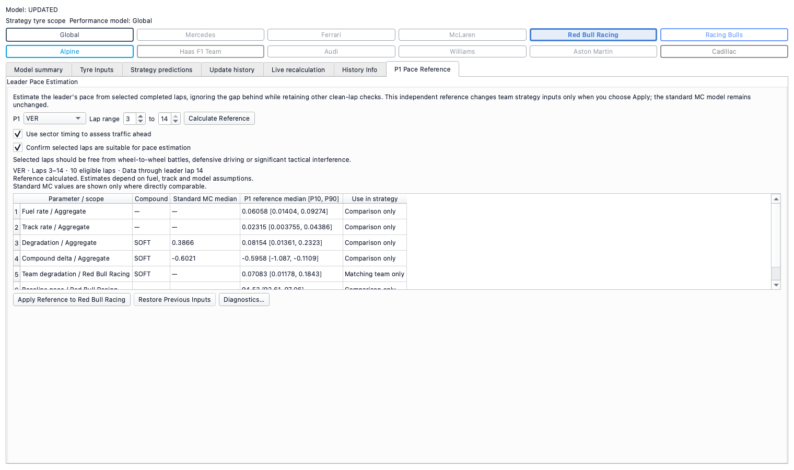
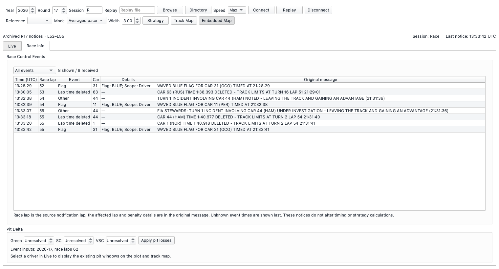

# 26R17-R development delivery

Final acceptance on 2026-10-18: **DEV-01 PASS; DEV-02 PASS**. Both features are
implemented. The earlier DEV-01 deferral was resolved by the explicit manual P1
reference contract; the investigation remains as historical evidence.

See [the final acceptance report](26R17_FINAL_ACCEPTANCE.md) for final regression
results, baseline exceptions, independent review and refreshed offscreen GUI
screenshots. Changes are committed separately in woData and woPlanner; nothing
was pushed. Unrelated local and concurrent work remains outside those commits.

## DEV-01 — P1 Pace Reference

Strategy contains **P1 Pace Reference**, with **Leader Pace Estimation**, **Lap
range** and **Calculate Reference**. A fresh interface leaves **Confirm selected
laps are suitable for pace estimation** unchecked. The operator must explicitly
confirm suitability before calculation or application is possible.

Only rear-gap clearance and rear-crossing support are waived. P1 position,
observed range, complete ahead evidence, clean-lap policy, consecutive-run rules
and existing statistical quality checks remain active. The separate reference
uses the existing fitter and cannot publish into the standard MC lane. Only
supported observed-compound degradation for the leader's matching team can be
applied. Restore, replay rewind/reset, reopening and saved-state isolation are
covered by actual GUI operations and regression tests.

Final independent review found that the shared worker serializer forwarded the
new P1 race-distance metadata into standard MC. This was corrected before commit:
only the P1 request opts into that metadata, retaining the prior standard worker
contract. Exact numerical comparisons cover the standard worker as well as the
direct service. See [implementation and usage](26R17_P1_REFERENCE.md).

## DEV-02 — Race Info

The live window has Live and Race Info tabs. Race Info contains Race Control
Events followed by the existing Pit Delta controls. Filtering supports All
events, Penalty and Lap time deleted, retaining original messages and source
notification laps. Sparse corrections, duplicate suppression, ordering,
recovery without incoming notices and recorded replay share the same history.

Pit Delta uses the original controls, calculations and persistence. Returning to
Live refreshes the hidden map even when replay is paused. Race Control updates
cannot change classification, timing laps or strategy. See [source and usage
details](RACE_INFO.md).

## Evidence and limits

The checked-in R17 P1 fixture contains original delivery prefixes, without later
race observations. The Race Control fixture contains eight archived L52–L55
notices, including three deleted-lap messages. It is not an original live-feed
recording: the old R17 raw recording never subscribed to that topic. Penalty
coverage uses explicitly synthetic notices because that archive has none.

Actual Qt windows, real spawned P1 calculation, Apply/Restore, tab switching,
replay/reset and reopening were exercised with QT_QPA_PLATFORM=offscreen and
MPLBACKEND=Agg. Final screenshots use a white background and were inspected.
No authenticated live connection or manual GUI operation was required.
