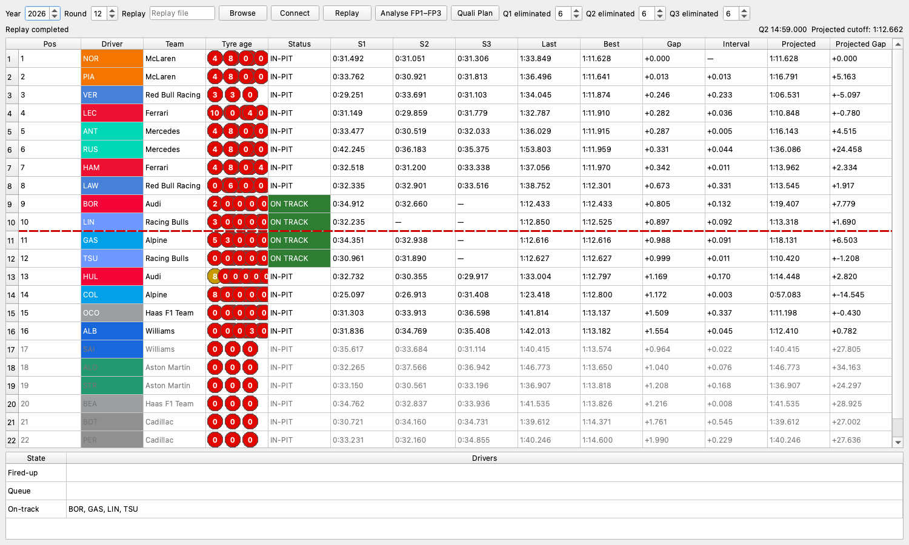

# Qualifying Monitor

Last reviewed: 2026-09-14

This document is the operating and maintenance guide for `woplanner-quali`.
The monitor combines FastF1 live timing, qualifying-only state reduction,
elimination/cutoff projection, FP-derived planning defaults, and a run timeline.
It supports conventional Qualifying and Sprint Qualifying without importing the
standard or live-race planner implementations.

## Run it

Install the sibling projects in dependency order and launch the entry point:

```bash
pip install -e ../Fast-F1
pip install -e "../woData[live]"
pip install -e ../woStrategy
pip install -e .
woplanner-quali
```

**Connect** starts authenticated FastF1 SignalR ingestion and records every raw
message under the shared `woData` root before reduction. **Replay** accepts a
legacy live `*.txt` recording or versioned replay input and sends it through the
same reducer/service path. The live source disables the old 60-second idle
timeout so connecting shortly before a session does not discard the feed during
a quiet period.

The following screenshot shows the recovered Round 12 Q2 replay used to verify
the live calculations and display states:



`SessionInfo` updates the displayed year, round, event, and session type. A Race,
Practice, or other non-qualifying session is rejected, its timing table is
cleared, and the analysis/plan actions remain unavailable. Sprint Qualifying is
labelled SQ1/SQ2/SQ3 and uses its own segment durations.

## Timing table

The table shows position, driver/team, status, sectors, last/best lap, gaps, and
current/projected cutoff values. Team colours come from `wodata.colours`.
Its row order follows the feed's official **Position**; calculated valid-lap
rank is retained separately for cutoff calculations. The current best follows
current official timing, so a deleted or retracted lap cannot remain the current
result. Checkpoint-based lap projection is shown only when the reference
checkpoints can be associated with that same valid best lap; otherwise that
projection is withheld rather than mixing laps.

Status backgrounds are deliberately operational rather than copies of FastF1's
display strings:

| Status | Background | Meaning |
| --- | --- | --- |
| Inactive | default/white | No current fired-up or moving evidence |
| Fired-up | amber | Fresh non-zero RPM while still in the garage/pit state |
| Queue | red | Moving through pit lane but not yet confirmed past pit exit |
| On track / leave pit | green | Position or speed confirms the car left pit lane |
| Inlap | blue | The car is approaching/entering pit lane |
| In-pit | white | Position confirms the car is inside pit lane |

Queue ordering uses circuit pit-lane geometry when a cached centreline exists.
Without geometry, speed and incremental `InPit` transitions provide the fallback.
Telemetry and geometry have freshness windows. Message-driven queue inference
clears brief movement evidence on later stationary/zero-RPM observations and
uses UNKNOWN for an unconfirmed departure after evidence expires.

### Tyre age

Each circle represents one `TimingAppData` stint. Its colour is the compound and
the number is FastF1 `StartLaps`: the physical tyre set's completed-lap age when
that stint began. A new set therefore shows `0`; the number is not the driver's
qualifying lap number and is not the set's age at the end of the stint. Stints
without `StartLaps` are omitted. If no driver has genuine start-age data, the
entire **Tyre age** column is hidden instead of fabricating a value.

### Finished and chequered state

**SESSION CHEQUERED** is session-level normal finish, driven by zero countdown,
explicit track-wide RaceControlMessages CHEQUERED, or finished/finalised status.
A completed PUSH with insufficient COOL/PREP time separately marks that car
**EFF. FINISH** and colours its position amber. Its tooltip records remaining
seconds, required seconds and operational-input provenance. This is not a
session flag. A recognised final-lap completion displays a chequered marker for
that driver. Both states reset for the next segment.

A driver still in the pit receives the same amber indication when remaining
time is strictly less than the existing OUT-lap requirement, without needing
a newly completed PUSH. The tooltip explains the OUT requirement and its source.
These checks allow time to reach the next PUSH start; they do not require that
PUSH to finish before session zero. The pit finish reason and cutoff calculation
are unchanged, and an unstarted archive clock at zero does not trigger a warning.
For example, with 150 s remaining, a 100 s OUT and a 90 s PUSH still permit a
new opportunity: PUSH starts with 50 s remaining and completes 40 s after zero.
The equivalent on-track check likewise excludes PUSH duration from COOL/PREP.
PREP is optional per planned run; the live driver state has no selected run or
per-driver prep requirement, so the live pit warning does not assume a PREP lap.

An operational completed `FAST` timed lap can count as a PUSH for effective
finish even when it fails the stricter 2% quality filter for a track-evolution
sample. The latter controls the evolution fit, not the driver finish decision.
COOL/PREP timing follows the shared Plan policy below; without a usable value,
no cool-duration-based effective finish is asserted.

## Clock and session-part handling

Qualifying domain state advances once per ordered message. `snapshot()` and
empty GUI polls are read-only: no local wall-clock extrapolation feeds domain
state. Between ExtrapolatedClock anchors, message timestamps (including
Heartbeat/telemetry messages) advance the countdown. During complete feed
silence the domain clock stays at its last observed value.

Zero is a valid countdown. Explicit segment metadata takes precedence. Without
it, a segment advances only after an observed zero-to-reset lifecycle transition;
a late connection at a generic 15:00 remains Q1. Centralized
`wodata.live.quali_clock` defaults describe segments but do not identify one.
An archive's pre-session zero does not establish a normal Qualifying finish;
zero after a positive segment countdown remains a valid finish. Live late-join
finish semantics are preserved. Q3 is 13 minutes. Red-flag/aborted status freezes
the message clock until restart.
Current timing and completed-lap state reset at segment boundaries; historical
Q1/Q2 best results remain separately available on the raw and planner models.
Official empty BestLapTime is not replaced by an untimed out-lap duration.

The optional historical table column is omitted in this pass: on the measured
16-inch MacBook display, the normal 1500-pixel window gives existing data columns
98–99 logical pixels, while a combined Q1/Q2 cell needs about 169 pixels. The
current result columns are not compressed to accommodate it.

Default planning durations are:

| Session | Q1 | Q2 | Q3 |
| --- | ---: | ---: | ---: |
| Qualifying | 18 min | 15 min | 13 min |
| Sprint Qualifying | 12 min | 10 min | 8 min |

The Plan window formats latest-start offsets as minutes and seconds and supports
multiple arrangements of out, prep, push, cool, in, and turnaround segments.
Each arrangement has a default-off **DY** checkbox. Selecting it reserves one
worst-case Double Yellow allowance: OUT + PUSH + IN, plus PREP when the first
run requires it. The existing run durations, turnarounds and margin still apply;
the allowance is added once per arrangement, regardless of its run or PUSH count.
Its timeline moves earlier and the release label shows the required remaining
countdown, the allowance and the comparison with DY off. Disabling DY restores
the original timing. A negative latest release remains visible as infeasible.
Click **Analyse FP1–FP3** to load the available practice sessions, combine their
laps for pre-Qualifying analysis, save `lap_roles.csv`, `duration_summary.csv`,
`track_progression.csv`, and `manifest.json` under the event's
`woData/wostrategy/pre_quali` artifact directory, and load the result into
operational Qualifying state. An unavailable individual FP session is skipped;
if none load, analysis fails.
Opening Plan alone can read an existing artifact but does not regenerate analysis.

Opening or refreshing Plan only reads current live timing and track state: it
does not reload different cached values or change existing overrides. Timing
inputs display to 0.1 s, while calculations retain full precision. An edit is
an explicit manual override; **Reset / reload** explicitly clears manual timing
overrides. Effective COOL/PREP priority is manual override, FP-derived estimate,
FP best/representative lap × 1.30, then unavailable with manual entry required.
There is no generic fixed 105 s fallback. The displayed countdown advances
locally between feed anchors for readability only; it cannot change domain
state or finish decisions.

### Presentation-clock snapshot contract

`QualiSessionSnapshot` carries `clock_running` and
`clock_anchor_session_time_s` from the raw qualifying clock so the GUI can make
that display-only interpolation decision without reaching into reducer state.
`clock_running=False`, a normal finish, or a terminal session status freezes the
presentation countdown at its received value. These fields are presentation
metadata: the service does not derive rankings, finish markers, or timing
decisions from local wall-clock time.

## Live track evolution and cutoff projection

A completed operational `FAST` push is eligible for the evolution sample only
when it also lies within 2% of the current fastest valid qualifying time. These
quality-filtered times are appended in observed order. As soon as two such
samples exist in the current Q/SQ part, every new sample refits the established
linear `woStrategy` model. The source changes from **FP prior** to, for example,
**Q2 live estimate**, and Plan shows the effective value and evidence count.

For Q1/Q2, a negative live slope means improving lap times and a faster
projected elimination cutoff. The forecast approximates one further field push
per active unfinished driver:

```text
projected correction = track rate * unfinished driver count
projected cutoff     = min(current valid cutoff, current cutoff + projected correction)
```

The published cutoff cannot be slower than the already observed valid cutoff
at that rank. Q3 targets P1 rather than an elimination rank.

The Plan window's **Use override** value affects the effective projection but
does not stop or replace automatic fitting. Clearing the override restores the
newest live estimate. Reloading FP analysis cannot overwrite a qualifying fit
that already has support.

## Round 12 replay reference

The Dutch GP Round 12 recordings exposed two old lifecycle problems: the live
source could time out before Q1, and a recording directory could reflect stale
pre-connect controls even though embedded `SessionInfo` identified the correct
event. The substantial Round 12 capture was consequently stored below a
`round=1` directory. Always trust embedded session identity when diagnosing an
old recording.

Replaying the Q1/Q2 capture after the fixes produced:

| Evidence | Result |
| --- | ---: |
| Q1 push laps | 18 |
| Q2 push laps | 27 |
| Effective source before Q3 | Q2 live estimate |
| Q2 rate | -0.00416 s/field push |

Mercedes driver 63's two new SOFT stints both expose `StartLaps=0`, which is the
expected displayed starting age. The shorter file actually stored under the
Round 12 directory ends before Q1 with empty stint lists and cannot validate Q2
behavior.

## Deliberate compromises and limits

- FAST/SLOW pace classification uses live/FP reference evidence, not an official
  push/prep label. The separate 2% quality filter may exclude a valid
  operational push from the evolution fit.
- The linear fit orders heterogeneous drivers' push times without driver,
  compound, traffic, wind, or fuel fixed effects. Two points are sufficient for
  responsiveness, so the earliest estimate can be noisy. It is operational
  guidance, not a causal track-only measurement.
- `unfinished driver count` is a one-more-push approximation, not a simulation of
  each driver's remaining stint plan. Q1/Q2 project the elimination cutoff; Q3
  instead projects the current P1 target.
- Qualifying subscribes to RaceControlMessages; race subscriptions are unchanged.
- Tyre history is only as complete as public `TimingAppData`. Missing
  `StartLaps` remains missing; no qualifying-lap fallback is allowed.
- Session-part recovery relies on standard duration/reset patterns. Red flags,
  shortened segments, or a late feed with an already-decremented anchor can
  reduce certainty until the next unambiguous reset.
- New qualifying recordings start with a unique provisional capture filename.
  Validated feed year/event-round/session relocates that capture into the matching
  directory without overwriting or merging existing files. An adjacent
  `.identity.json` retains manual and validated identities, mismatch and path.
  Unresolved identity remains explicitly provisional. Older recordings are not
  migrated; inspect embedded identity for those captures.
- Disabling the idle timeout keeps pre-session connections alive but does not add
  automatic SignalR reconnection after a genuine network close; reconnect from
  the UI when the source reports disconnection.
- Pit queue/on-track distinction is strongest with cached pit-lane geometry.
  Speed-only fallback cannot locate the exact pit-exit line.

These choices favour transparent missing data, low live latency, and reuse of
the existing strategy model over silently invented tyre/session values or a
separate qualifying-only statistical stack.

## Validation

Focused tests cover standard and sprint session transitions, clock extrapolation,
late connection, non-qualifying rejection, status colours, true tyre starting
age, hidden missing-data columns, chequer reset, live track refitting, manual
override isolation, cutoff sign, planning durations, and NaN-safe formatting.

Run the relevant suites from the workspace root:

```bash
PYTHONPATH=woData/src .venv/bin/python -m pytest woData/tests -q
PYTHONPATH=woPlanner/src:woData/src:woStrategy/src \
  .venv/bin/python -m pytest woPlanner/tests --ignore=woPlanner/tests/test_service.py -q
```

## Determinism regression

`tests/test_quali_replay_determinism.py` runs the R13 archive through the real
controller/reducer/service path with batches 1, 7 and 500; replay speeds 0, 25
and 1 use a virtual scheduler to avoid real-time waits. It compares every
canonical identity, segment, countdown/normal-finish, lap, best/reference,
queue, effective-finish, ranking and target transition. See `assets/qualifying_correctness_r13.json`
and `QUALIFYING_CORRECTNESS_PASS.md` for evidence and review excerpts.
